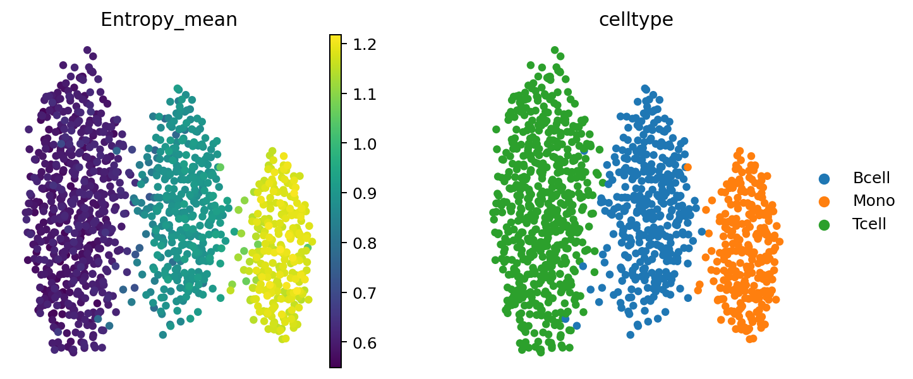
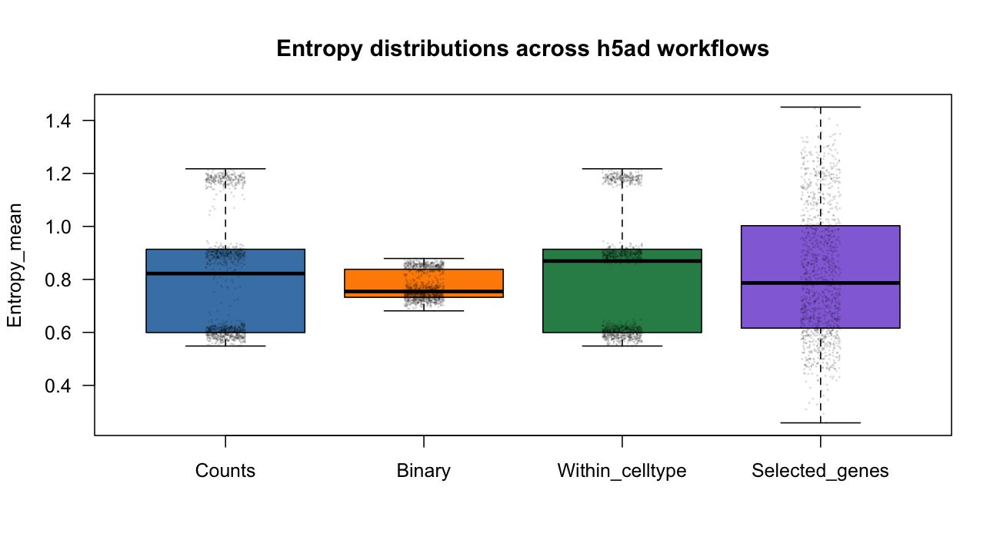

This vignette demonstrates a complete workflow for computing gene expression
entropy from a Python `AnnData` object. Python and Scanpy are used to prepare
the data, the `Entropy` package performs the calculation directly from an
`.h5ad` file, and the resulting per-cell entropy is added back to
`adata.obs`.

The recommended workflow is file based:

1. prepare and save the `AnnData` object in Python;
2. call `run_entropy_h5ad()` in R;
3. write the per-cell result to CSV;
4. read the result into Python and join it to `adata.obs`.

This approach does not require `rpy2` and works from Python scripts, notebooks,
workflow managers, and the command line.

## Requirements

Direct h5ad support requires:

- R version 4.5.0 or newer;
- `Entropy`;
- the Bioconductor packages `anndataR` version 1.0.0 or newer and `rhdf5`;
- Python with `anndata`, `scanpy`, and `pandas`.

Install the R dependencies:

```{r, eval=FALSE}
install.packages("BiocManager")
BiocManager::install(c("anndataR", "rhdf5"))

install.packages("devtools")
devtools::install_gitlab(
  "zaugg-group/entropy_package",
  host = "git.scicore.unibas.ch",
  force = TRUE
)
```

Install the Python dependencies in the environment used for the Scanpy
analysis:

```bash
python -m pip install anndata scanpy pandas
```

Check the R installation:

```{r, eval=FALSE}
R.version.string
packageVersion("Entropy")
packageVersion("anndataR")
packageVersion("rhdf5")
```

## What the h5ad file must contain

For the standard automatic-neighbor workflow, the `.h5ad` file should contain:

- unique cell identifiers in `adata.obs_names`;
- unique feature identifiers in `adata.var_names`;
- a non-negative raw-count matrix in a layer such as
  `adata.layers["counts"]`;
- a cell-by-component embedding in `adata.obsm["X_pca"]`.

If `restrict_by` will be used, the corresponding column must also be present
in `adata.obs`, for example `adata.obs["celltype"]`.

AnnData stores expression as cells by genes. `run_entropy_h5ad()` transposes
this internally to the genes-by-cells representation used by the entropy
engine.

### Important: preserve raw counts

Counts mode requires non-negative integer counts. A normalized or
log-transformed `adata.X` must not be used as count input. Preserve raw counts
in a layer before normalizing:

```python
import scanpy as sc

adata = sc.read_h5ad("input.h5ad")

# Do this before normalization if a counts layer is not already present.
adata.layers["counts"] = adata.X.copy()

sc.pp.normalize_total(adata, target_sum=1e4)
sc.pp.log1p(adata)
sc.pp.pca(adata, n_comps=50)

adata.write_h5ad("adata_for_entropy.h5ad")
```

If the object already has `layers["counts"]` and `obsm["X_pca"]`, it can be
written directly:

```python
required = {
    "counts layer": "counts" in adata.layers,
    "PCA embedding": "X_pca" in adata.obsm,
}
assert all(required.values()), required

assert adata.obs_names.is_unique
assert adata.var_names.is_unique

adata.write_h5ad("adata_for_entropy.h5ad")
```

## Run entropy in counts mode

Open R in the directory containing `adata_for_entropy.h5ad`, or use an absolute
file path.

```{r, eval=FALSE}
library(Entropy)

entropy_mean <- run_entropy_h5ad(
  path = "adata_for_entropy.h5ad",
  layer = "counts",
  neighbors_method = "auto",
  pca_key = "X_pca",
  dims = 20,
  k = 15,
  mode = "counts"
)

head(entropy_mean)
summary(entropy_mean$Entropy_mean)

hist(
  entropy_mean$Entropy_mean,
  main = "Mean entropy distribution",
  xlab = "Entropy_mean",
  col = "steelblue"
)
```

The returned data frame has one row per cell. Its row names are the original
`adata.obs_names`, and the `Entropy_mean` column contains the mean gene-expression
entropy for each cell.

As of Entropy 0.7.0, `k` means `k` other cells and never includes the focal
cell. Results therefore differ slightly from values produced with 0.6.0 and
should not be compared across those versions.

The h5ad path also validates every supplied custom neighbour list. A cell
cannot name itself, every non-empty list must have the same size, and an
explicit `k` must equal that size. A custom list that worked in 0.6.0 can now
error; remove self entries, make the list sizes equal, and either pass the
matching `k` or leave `k` unset so it is inferred.

For example, the first rows for the bundled synthetic AnnData test object are:

```text
          Entropy_mean
cell_0000    0.8869367
cell_0001    0.5902047
cell_0002    0.5588701
cell_0003    0.5995878
cell_0004    1.1917657
cell_0005    1.1746165
```

The corresponding R summary is:

```text
   Min. 1st Qu.  Median    Mean 3rd Qu.    Max.
 0.5485  0.5993  0.8220  0.8087  0.9136  1.2174
```

Write the result for Python:

```{r, eval=FALSE}
write.csv(
  entropy_mean,
  file = "Entropy_mean.csv",
  quote = FALSE
)
```

## Add the result to AnnData

Read the output in Python and align it explicitly by cell identifier:

```python
import pandas as pd
import scanpy as sc

adata = sc.read_h5ad("adata_for_entropy.h5ad")
entropy = pd.read_csv("Entropy_mean.csv", index_col=0)["Entropy_mean"]

missing = adata.obs_names.difference(entropy.index)
extra = entropy.index.difference(adata.obs_names)
assert len(missing) == 0, f"Missing entropy values for {len(missing)} cells"
assert len(extra) == 0, f"Entropy output has {len(extra)} unknown cells"

adata.obs["Entropy_mean"] = entropy.reindex(adata.obs_names)
assert adata.obs["Entropy_mean"].notna().all()

print(adata.obs[["Entropy_mean"]].head())
print(adata.obs["Entropy_mean"].describe())

adata.write_h5ad("adata_with_entropy.h5ad")
```

If the object does not already have a UMAP, construct one from the existing
PCA representation. Then plot the same cells by mean entropy and by cell type:

```python
if "X_umap" not in adata.obsm:
    sc.pp.neighbors(adata, use_rep="X_pca", n_neighbors=15)
    sc.tl.umap(adata, random_state=42)

sc.pl.umap(
    adata,
    color=["Entropy_mean", "celltype"],
    color_map="viridis",
    frameon=False,
    wspace=0.35,
)
```

```{r, echo=FALSE, out.width="100%", fig.cap="UMAP of the bundled synthetic AnnData object. The same embedding is coloured by mean entropy (left) and cell type (right)."}

```

## Run entropy in binary mode

Binary mode converts expression to presence or absence (`counts > 0`) and
computes Bernoulli Shannon entropy. The result lies between 0 and 1.

```{r, eval=FALSE}
entropy_binary <- run_entropy_h5ad(
  path = "adata_for_entropy.h5ad",
  layer = "counts",
  neighbors_method = "auto",
  pca_key = "X_pca",
  dims = 20,
  k = 15,
  mode = "binary"
)

head(entropy_binary)
summary(entropy_binary$Entropy_mean)

hist(
  entropy_binary$Entropy_mean,
  main = "Binary entropy distribution",
  xlab = "Entropy_mean",
  col = "darkorange"
)

write.csv(
  entropy_binary,
  file = "entropy_binary.csv",
  quote = FALSE
)
```

On the bundled synthetic object, `summary(entropy_binary$Entropy_mean)`
produces:

```text
   Min. 1st Qu.  Median    Mean 3rd Qu.    Max.
 0.6812  0.7323  0.7545  0.7751  0.8380  0.8789
```

Add it to the same AnnData object:

```python
binary = pd.read_csv("entropy_binary.csv", index_col=0)["Entropy_mean"]
adata.obs["Entropy_binary"] = binary.reindex(adata.obs_names)

assert adata.obs["Entropy_binary"].notna().all()
assert adata.obs["Entropy_binary"].between(0, 1).all()
print(adata.obs["Entropy_binary"].describe())
```

## Restrict neighbors within groups

The `restrict_by` argument computes neighborhoods within a column of
`adata.obs`. This is useful when entropy should be measured within cell types,
samples, batches, conditions, or other predefined groups.

First confirm that the column is present:

```python
assert "celltype" in adata.obs.columns
print(adata.obs["celltype"].value_counts(dropna=False))
```

Run entropy using only neighbors with the same `celltype`:

```{r, eval=FALSE}
entropy_within_celltype <- run_entropy_h5ad(
  path = "adata_for_entropy.h5ad",
  layer = "counts",
  neighbors_method = "auto",
  restrict_by = "celltype",
  pca_key = "X_pca",
  dims = 20,
  k = 15,
  mode = "counts"
)

head(entropy_within_celltype)
summary(entropy_within_celltype$Entropy_mean)

boxplot(
  Unrestricted = entropy_mean$Entropy_mean,
  Within_celltype = entropy_within_celltype$Entropy_mean,
  ylab = "Entropy_mean",
  col = c("steelblue", "seagreen"),
  main = "Effect of restricting neighbors"
)

write.csv(
  entropy_within_celltype,
  file = "entropy_within_celltype.csv",
  quote = FALSE
)
```

For the bundled object, the within-cell-type result is:

```text
   Min. 1st Qu.  Median    Mean 3rd Qu.    Max.
 0.5485  0.5993  0.8692  0.8135  0.9136  1.2174
```

For automatic neighbors, each group needs at least `k + 1` cells. Cells in
smaller groups receive entropy 0 because a valid neighborhood cannot be
constructed. Cells with a missing value in `restrict_by` also receive entropy
0.

## Chunked computation for larger objects

Chunking reduces the cost of repeatedly subsetting a large sparse matrix. It
does not change the cell neighborhoods or the expected entropy result.

```{r, eval=FALSE}
entropy_chunked <- run_entropy_h5ad(
  path = "adata_for_entropy.h5ad",
  layer = "counts",
  neighbors_method = "auto",
  pca_key = "X_pca",
  dims = 20,
  k = 15,
  mode = "counts",
  chunk_method = "auto",
  chunk_cells = 2000
)

head(entropy_chunked)
all.equal(entropy_chunked, entropy_mean, tolerance = 1e-12)
```

The equality check should return:

```text
[1] TRUE
```

Chunking is most useful for objects with many cells. If the object has fewer
than twice `chunk_cells`, the function warns and uses the unchunked path.
Values between 1,000 and 5,000 cells per chunk are usually reasonable.

On macOS and Linux, chunks can optionally be processed in parallel:

```{r, eval=FALSE}
entropy_chunked_parallel <- run_entropy_h5ad(
  path = "adata_for_entropy.h5ad",
  layer = "counts",
  chunk_method = "auto",
  chunk_cells = 2000,
  parallelize = TRUE,
  n_cores = 4
)

summary(entropy_chunked_parallel$Entropy_mean)
```

Parallel chunk processing is not supported on Windows.

## Restrict the scored genes

The PCA embedding defines the neighborhoods, while `features` controls which
genes are scored. This is useful for a targeted gene set and can substantially
reduce runtime.

Create a text file in Python:

```python
genes = ["CD3D", "CD3E", "CD8A", "IL7R"]

missing = sorted(set(genes).difference(adata.var_names))
assert not missing, f"Genes missing from AnnData: {missing}"

with open("entropy_features.txt", "w") as handle:
    handle.write("\n".join(genes))
```

Read the genes and run entropy in R:

```{r, eval=FALSE}
features <- readLines("entropy_features.txt")

entropy_selected_genes <- run_entropy_h5ad(
  path = "adata_for_entropy.h5ad",
  layer = "counts",
  features = features,
  k = 15,
  mode = "counts"
)

head(entropy_selected_genes)
summary(entropy_selected_genes$Entropy_mean)

hist(
  entropy_selected_genes$Entropy_mean,
  main = "Selected-gene entropy distribution",
  xlab = "Entropy_mean",
  col = "mediumpurple"
)
```

The returned per-cell value is the mean entropy across the selected genes.
For four selected genes in the bundled synthetic object, the result is:

```text
   Min. 1st Qu.  Median    Mean 3rd Qu.    Max.
 0.2585  0.6161  0.7865  0.8210  1.0024  1.4502
```

### Compare the results

The different modes produce visibly different per-cell distributions. The
following values and plot were generated with the bundled 1,200-cell AnnData
object. The selected-gene example uses `gene_000` through `gene_003`.

| Workflow | Minimum | Median | Mean | Maximum |
|:--|--:|--:|--:|--:|
| Counts | 0.5485 | 0.8220 | 0.8087 | 1.2174 |
| Binary | 0.6812 | 0.7545 | 0.7751 | 0.8789 |
| Within cell type | 0.5485 | 0.8692 | 0.8135 | 1.2174 |
| Four selected genes | 0.2585 | 0.7865 | 0.8210 | 1.4502 |

```{r, echo=FALSE, out.width="100%", fig.cap="Per-cell entropy distributions from the counts, binary, within-cell-type, and selected-gene workflows."}

```

## Save the full gene-by-cell entropy matrix

By default, only the per-cell mean data frame is returned. Set `output_path`
to save the full gene-by-cell matrix as an RDS file:

Restartable gene blocking is currently available only through the Seurat
`run_entropy()` path. `run_entropy_h5ad()` still constructs the complete
gene-by-cell entropy matrix in memory before saving it, including when cell
chunking is enabled.

```{r, eval=FALSE}
entropy_means <- run_entropy_h5ad(
  path = "adata_for_entropy.h5ad",
  layer = "counts",
  output_path = "entropy_gene_by_cell.rds"
)
```

RDS is an R-native format. For modest matrices, it can be converted to a
cell-by-gene CSV for Python:

```{r, eval=FALSE}
entropy_gene_by_cell <- readRDS("entropy_gene_by_cell.rds")

dim(entropy_gene_by_cell)
summary(as.vector(entropy_gene_by_cell))

write.csv(
  t(entropy_gene_by_cell),
  file = "entropy_cell_by_gene.csv",
  quote = FALSE
)
```

For the bundled object, `dim(entropy_gene_by_cell)` returns 200 genes by 1,200
cells:

```text
[1]  200 1200
```

For large matrices, CSV is inefficient; retaining the RDS file or implementing
a project-specific sparse HDF5 export is preferable.

## Optional: call R directly from Python with rpy2

The file-based workflow is recommended because it is easy to reproduce and
debug. Users who already use `rpy2` can call the R function without creating
the intermediate CSV:

```bash
python -m pip install rpy2
```

```python
from rpy2.robjects import default_converter
from rpy2.robjects import pandas2ri
from rpy2.robjects.conversion import localconverter
from rpy2.robjects.packages import importr

entropy_r = importr("Entropy")

result_r = entropy_r.run_entropy_h5ad(
    path="adata_for_entropy.h5ad",
    layer="counts",
    k=15,
    mode="counts",
)

with localconverter(default_converter + pandas2ri.converter):
    result = pandas2ri.rpy2py(result_r)

result.index = list(result_r.rownames)
adata.obs["Entropy_mean"] = result["Entropy_mean"].reindex(adata.obs_names)
print(adata.obs["Entropy_mean"].describe())
```

`rpy2` must be configured to use an R installation that contains `Entropy`,
`anndataR`, and `rhdf5`.

## Choose and apply depth correction

Sequencing depth inflates entropy for a technical reason. Entropy is concave,
so subsampling biases its estimate downward, and a more deeply sequenced cell
can receive a higher score with no change in biology.

The automatic `entropy_depth_select()` sweep is currently Seurat-only. It needs
the Seurat count layer so it can restart many entropy runs while holding the
original detected-gene count, neighbour graph, and gene panel fixed. If your
analysis stays in AnnData, choose candidate quantiles in a parallel Seurat
analysis or run a small grid manually with `run_entropy_h5ad()`. Do not compare
runs that use different embeddings, neighbours, features, or random seeds.

The [Choosing depth correction](choosing_depth_correction.html) tutorial
explains the retained-variation frontier, its diagonal, and the retention
weight. Once a quantile is chosen, apply it directly on the h5ad path. Every
cell above the target is thinned to a common count depth before entropy is
estimated. Neighbourhoods are unchanged, only the counts fed to the estimator
are changed.

```{r, eval=FALSE}
corrected <- run_entropy_h5ad(
  "adata_for_entropy.h5ad",
  layer          = "counts",
  k              = 15,
  mode           = "counts",
  depth_correct  = TRUE,
  depth_quantile = 0.05,
  return_inputs  = TRUE
)

head(corrected$results)
#                  Entropy_mean Entropy_mean_depth_corrected depth_corrected
```

`depth_quantile` is approximately the fraction of cells left uncorrected, because
cells already below the target keep their counts. The `depth_corrected` column
marks which cells were actually thinned.

Write both scores back to `adata.obs` so the corrected and uncorrected versions
stay side by side:

```{r, eval=FALSE}
write.csv(corrected$results, "Entropy_with_depth_correction.csv")
```

```python
import pandas as pd
import scanpy as sc

adata = sc.read_h5ad("adata_for_entropy.h5ad")
scores = pd.read_csv("Entropy_with_depth_correction.csv", index_col=0)

assert len(adata.obs_names.difference(scores.index)) == 0

adata.obs["Entropy_mean"] = scores["Entropy_mean"].reindex(adata.obs_names)
adata.obs["Entropy_mean_depth_corrected"] = (
    scores["Entropy_mean_depth_corrected"].reindex(adata.obs_names)
)
adata.obs["depth_corrected"] = scores["depth_corrected"].reindex(adata.obs_names)

sc.pl.umap(
    adata,
    color=["Entropy_mean", "Entropy_mean_depth_corrected"],
    color_map="viridis",
    frameon=False,
    wspace=0.35,
)
```

Keep the corrected and uncorrected scores together, and report the quantile and
the rule used to select it.

## Troubleshooting

### Non-integer values in counts mode

If counts mode reports non-integer values, the selected layer is normalized or
log-transformed. Select the raw-count layer:

```{r, eval=FALSE}
run_entropy_h5ad(
  "adata_for_entropy.h5ad",
  layer = "counts",
  mode = "counts"
)
```

### Missing PCA embedding

Automatic neighbors and automatic chunking require the embedding selected by
`pca_key`. In Python:

```python
sc.pp.pca(adata, n_comps=50)
adata.write_h5ad("adata_for_entropy.h5ad")
```

Alternatively, set `pca_key` to another cell embedding stored in `adata.obsm`.

### Too few cells

Global automatic neighbors require at least `k + 1` cells. The counts
estimator also requires at least 11 neighbors, so a count-mode dataset needs at
least 12 cells.

### Results do not align with AnnData

Always join by cell identifier rather than by row position:

```python
adata.obs["Entropy_mean"] = entropy.reindex(adata.obs_names)
assert adata.obs["Entropy_mean"].notna().all()

sc.pl.umap(adata, color="Entropy_mean", color_map="viridis")
```

## Complete minimal workflow

Python:

```python
import scanpy as sc

adata = sc.read_h5ad("input.h5ad")
adata.layers["counts"] = adata.X.copy()
sc.pp.normalize_total(adata, target_sum=1e4)
sc.pp.log1p(adata)
sc.pp.pca(adata, n_comps=50)
adata.write_h5ad("adata_for_entropy.h5ad")
```

R:

```{r, eval=FALSE}
library(Entropy)

result <- run_entropy_h5ad(
  "adata_for_entropy.h5ad",
  layer = "counts",
  k = 15,
  mode = "counts"
)

write.csv(result, "Entropy_mean.csv", quote = FALSE)
```

Python:

```python
import pandas as pd

entropy = pd.read_csv("Entropy_mean.csv", index_col=0)["Entropy_mean"]
adata.obs["Entropy_mean"] = entropy.reindex(adata.obs_names)
assert adata.obs["Entropy_mean"].notna().all()

if "X_umap" not in adata.obsm:
    sc.pp.neighbors(adata, use_rep="X_pca", n_neighbors=15)
    sc.tl.umap(adata, random_state=42)

sc.pl.umap(adata, color="Entropy_mean", color_map="viridis")
adata.write_h5ad("adata_with_entropy.h5ad")
```

Before interpreting the result, use the depth-selection workflow described in
[Choose and apply depth correction](#choose-and-apply-depth-correction). The
automatic selector is Seurat-only; AnnData users can apply a selected quantile
with `depth_correct = TRUE` and should report both the quantile and the
uncorrected comparison.
